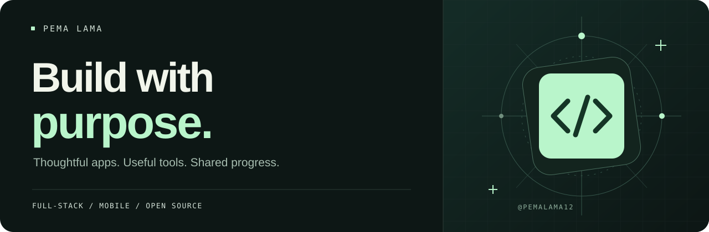

  

  <a href="https://www.linkedin.com/in/sangpo-lama-482171213/">LinkedIn</a>
  &nbsp; / &nbsp;
  <a href="https://github.com/pemalama12?tab=repositories">Projects</a>
  &nbsp; / &nbsp;
  <a href="https://github.com/search?q=is%3Apr+author%3Apemalama12+-user%3Apemalama12&amp;type=pullrequests">Open-source work</a>

## Hey, I'm Pema.

I'm a full-stack developer building web and mobile apps, learning by shipping, and contributing to open source. I enjoy turning everyday problems into software that's straightforward to use — from splitting a dinner bill to making a command-line tool work better.

Right now, I'm building **[Split-app](https://github.com/pemalama12/Split-app)** and growing as an open-source contributor through focused changes, tests, and documentation.

 

## Things I'm building

<table>
  <tr>
    <td width="50%" valign="top">
      <h3>Split-app</h3>
      
<strong>Shared expenses. Less mental math.</strong>

      
A mobile app for shared bills, receipt items, group balances, and settlements. Built for iOS and Android, with real-time data and account-free group members.

      
<code>TypeScript</code> <code>React Native</code> <code>Expo</code> <code>Convex</code> <code>Clerk</code>

      
<a href="https://github.com/pemalama12/Split-app"><strong>Explore the project →</strong></a>

    </td>
    <td width="50%" valign="top">
      <h3>The Pema Den</h3>
      
<strong>A place to manage the stay.</strong>

      
A hotel booking management web app. A project for putting React, server-state management, and a hosted backend together in a practical interface.

      
<code>JavaScript</code> <code>React</code> <code>React Query</code> <code>Supabase</code>

      
<a href="https://github.com/pemalama12/pema-den"><strong>Explore the project →</strong></a>

    </td>
  </tr>
</table>

## Building in the open

I want my contributions to make someone else's work easier. Here are a few pull requests I've submitted:

| Project | Contribution |
| :--- | :--- |
| [jsonfmt-cli](https://github.com/yunaremaia/jsonfmt-cli/pull/9) | In-place JSON formatting with symlink refusal and permission preservation. |
| [crypto-price-cli](https://github.com/yunaremaia/crypto-price-cli/pull/71) | JSON Lines output for refresh streams and shell pipelines. |
| [fx-rate-cli](https://github.com/yunaremaia/fx-rate-cli/pull/49) | JSON Lines output, including grouped currency conversions. |
| [Aiset](https://github.com/JamshidS/aiset/pull/99) | An alternate transcript root for isolated demos and tests. |
| [OMK](https://github.com/dmae97/omk/pull/312) | Tests for HTTP-header normalization and duplicate-header behavior. |

[See contribution activity →](https://github.com/search?q=is%3Apr+author%3Apemalama12+-user%3Apemalama12&type=pullrequests)

## My toolkit

| Area | Technologies |
| :--- | :--- |
| **Languages** | TypeScript · JavaScript · Python |
| **Web** | React · Next.js · Tailwind CSS |
| **Mobile** | React Native · Expo |
| **Backend & data** | Node.js · Express · Convex · Supabase · MongoDB |
| **Practice** | Git · CLI tools · Testing · [Data structures & algorithms](https://github.com/pemalama12/DSA-practice) |

## Let's build something useful.

I'm interested in practical web and mobile projects, developer tools, and open-source problems I can help solve. Have something in mind? [Connect with me on LinkedIn](https://www.linkedin.com/in/sangpo-lama-482171213/).

 

Build something useful. Understand how it works. Make it better. Share what you learn.

